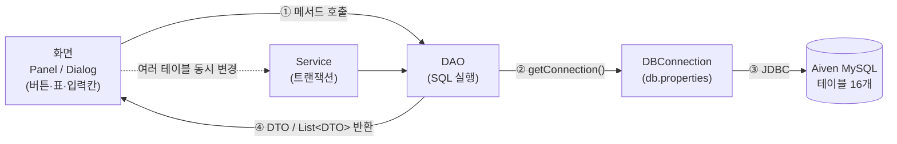
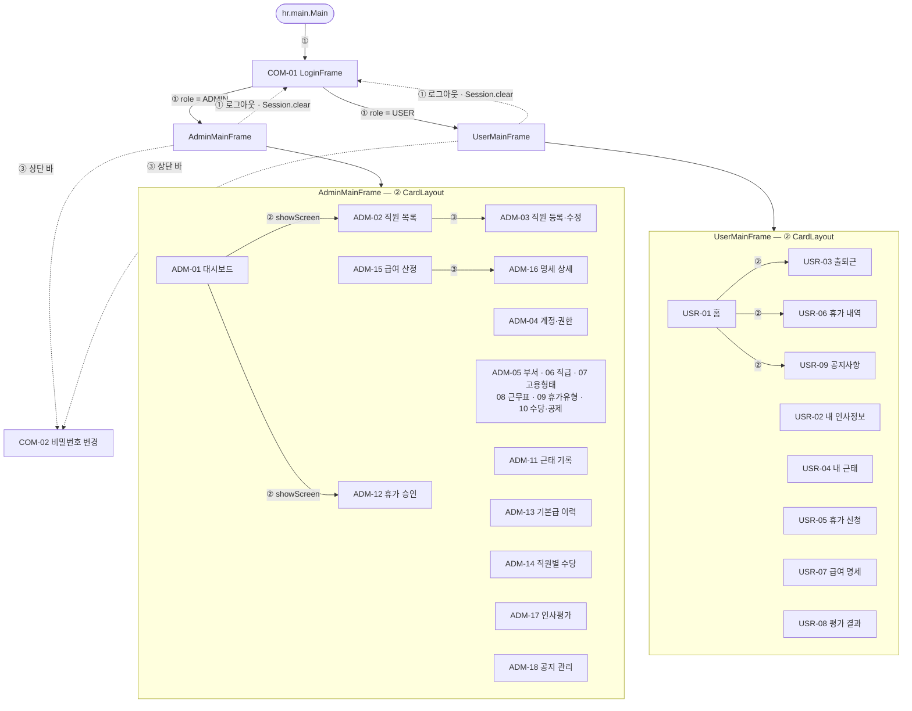
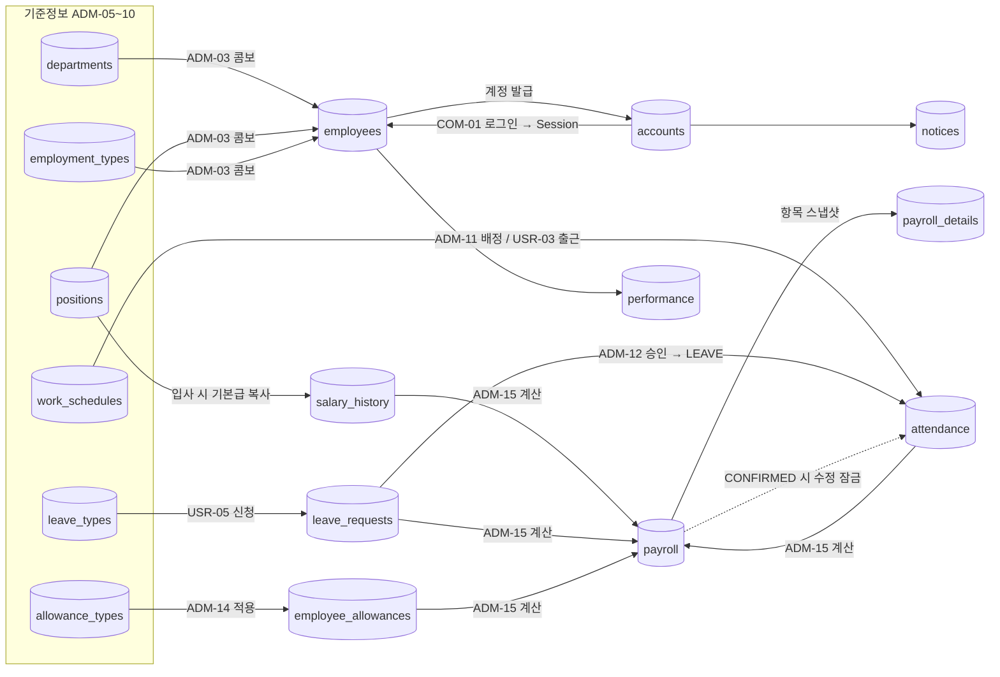
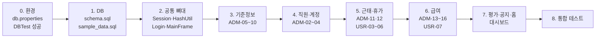

# OP-HR
객체지향언어실습 HR 프로그램 제작 팀 프로젝트 저장소

<nav>
  <li>개발 환경 동기화</li>
  <li>구조 설계</li>
  <li>역할 분담</li>
</nav>

## 1. 개발 환경
- JDK: Java 21
- Build System: Gradle
- Gradle DSL: Groovy
- UI: Java Swing (JFrame)
- Database: Aiven MySQL
- DB 관리: DBeaver
- DB ERD : ERDCloud
- 협업: GitHub

## 2. 프로젝트 계획 (예정)

OP-HR 전체 프로젝트 구조도
> Java 21 · Swing · Gradle · JDBC · Aiven MySQL
> 화면 29개 / 테이블 16개 / 5인 팀 (화면 1개 = 클래스 1개 = 담당자 1명)
---
1. 한눈에 보는 계층 구조
모든 화면은 같은 4단계로 DB와 연결된다. 화면(Panel)에는 SQL을 쓰지 않고, SQL은 DAO에만 둔다.

계층	역할	예시
View (Panel/Dialog)	화면 구성, 이벤트 처리, DAO 호출 결과를 표·폼에 표시	`DepartmentPanel`
Service	여러 테이블을 한 번에 바꾸는 처리 (commit / rollback)	`EmployeeService.resign()`
DAO	테이블 하나에 대한 SELECT / INSERT / UPDATE / DELETE	`DepartmentDAO.findAll()`
DTO	테이블 한 행을 담는 상자 (필드 + getter/setter)	`DepartmentDTO`
DBConnection	db.properties 를 읽어 Connection 생성 (기존 코드 유지)	`hr.db.DBConnection`
---
2. 폴더 · 파일 구조
```
OP-HR/                                   ← GitHub 저장소 루트
├─ README.md
├─ .gitignore                            ← db.properties, .idea, build 제외 (기존)
└─ HRManagement/                         ← Gradle 프로젝트 (IntelliJ에서 이 build.gradle 기준)
   ├─ build.gradle                       ← mysql-connector-j, mainClass = hr.main.Main (기존)
   ├─ settings.gradle
   ├─ sql/
   │  ├─ schema.sql                      ← 테이블 16개 CREATE (팀 공유, 실행 전 승인)
   │  └─ sample_data.sql                 ← 테스트용 기준정보·계정 데이터
   └─ src/main/
      ├─ resources/
      │  ├─ db.properties                ← 각자 생성, 커밋 금지 (url / user / password)
      │  └─ db.properties.example        ← 값 비운 공유용 양식 (커밋 O)
      └─ java/hr/
         ├─ main/        Main.java                     실행 시작 → LoginFrame
         ├─ db/          DBConnection.java, DBTest.java (기존 유지)
         ├─ common/      공통 클래스 (§3)
         ├─ dto/         테이블별 DTO 16개 (§4)
         ├─ dao/         테이블별 DAO 16개 (§4)
         ├─ login/       COM-01, COM-02
         ├─ admin/       ADM-01, ADM-04
         ├─ user/        USR-01, USR-02
         ├─ employee/    ADM-02, ADM-03 + EmployeeService
         ├─ master/      ADM-05 ~ ADM-10 (기준정보)
         ├─ attendance/  ADM-11, USR-03, USR-04
         ├─ leave/       ADM-12, USR-05, USR-06 + LeaveService
         ├─ payroll/     ADM-13 ~ ADM-16, USR-07 + PayrollCalculator
         ├─ evaluation/  ADM-17, USR-08
         └─ notice/      ADM-18, USR-09
```
---
3. 공통 클래스 (`hr.common`) — 가장 먼저 dev 에 병합
클래스	하는 일	담당
`Session`	로그인한 사람 정보 static 보관 (accountId, employeeId, username, role, name, employeeNo), `clear()`	장지원
`ComboItem`	콤보박스 항목 (id + name, `toString()` = name)	장지원
`HashUtil`	비밀번호 SHA-256 해시	강승준
`HeaderPanel`	메인 창 상단 바 (이름·권한, 비밀번호 변경, 로그아웃)	강승준
`AttendanceCalculator`	근무·연장·야간 분, 지각·조퇴 판정 (ADM-11, USR-03 공용)	장지원
메인 프레임 2개도 공통 뼈대에 포함한다.
클래스	하는 일	담당
`hr.admin.AdminMainFrame`	관리자 창: 상단 바 + 왼쪽 메뉴 + `CardLayout`, `showScreen(id)`	장지원
`hr.user.UserMainFrame`	사용자 창: 같은 구조	오은석
---
4. DTO / DAO (테이블 16개)
DAO는 그 테이블에 쓰기(INSERT/UPDATE) 를 하는 화면 담당자가 만들고, 다른 팀원은 조회 메서드를 가져다 쓴다.
다른 사람이 만든 DAO에 메서드를 추가할 때는 먼저 공유한다.
테이블	DTO	DAO	DAO 담당	쓰기 화면	조회 화면
accounts	`AccountDTO`	`AccountDAO`	강승준	COM-02, ADM-03, ADM-04	COM-01, ADM-18, USR-02, USR-09
employees	`EmployeeDTO`	`EmployeeDAO`	조민한	ADM-02, ADM-03, USR-02	거의 모든 화면
departments	`DepartmentDTO`	`DepartmentDAO`	조민한	ADM-05	ADM-02, 03, 11, 12, 15, 16, 17, USR-02
positions	`PositionDTO`	`PositionDAO`	조민한	ADM-06	ADM-02, 03, 13, 15, 16, USR-02
employment_types	`EmploymentTypeDTO`	`EmploymentTypeDAO`	강승준	ADM-07	ADM-02, 03, 13, 15, USR-02
work_schedules	`WorkScheduleDTO`	`WorkScheduleDAO`	강승준	ADM-08	ADM-11, 12, USR-01, 03, 04
leave_types	`LeaveTypeDTO`	`LeaveTypeDAO`	조민한	ADM-09	ADM-01, 12, 15, USR-01, 05, 06
allowance_types	`AllowanceTypeDTO`	`AllowanceTypeDAO`	강승준	ADM-10	ADM-14, 15, 16
attendance	`AttendanceDTO`	`AttendanceDAO`	장지원	ADM-11, ADM-12, USR-03	ADM-01, 08, 15, USR-01, 04
leave_requests	`LeaveRequestDTO`	`LeaveRequestDAO`	변재정	USR-05, USR-06, ADM-12, ADM-02	ADM-01, 09, 15, USR-01
salary_history	`SalaryHistoryDTO`	`SalaryHistoryDAO`	강승준	ADM-13, ADM-03, ADM-02	ADM-15
employee_allowances	`EmployeeAllowanceDTO`	`EmployeeAllowanceDAO`	장지원	ADM-14, ADM-02	ADM-10, 15
payroll	`PayrollDTO`	`PayrollDAO`	장지원	ADM-15	ADM-01, 11, 12, 13, 16, USR-01, 07
payroll_details	`PayrollDetailDTO`	`PayrollDetailDAO`	장지원	ADM-15	ADM-10, 16, USR-07
performance	`PerformanceDTO`	`PerformanceDAO`	변재정	ADM-17	USR-08
notices	`NoticeDTO`	`NoticeDAO`	오은석	ADM-18	ADM-01, USR-01, 09
Service (여러 테이블을 한 트랜잭션으로 변경)
클래스	처리	변경 테이블	담당
`employee.EmployeeService`	직원 등록 (직원 + 기본급 이력 + 계정), 퇴사 연쇄 처리	employees, salary_history, accounts, employee_allowances, leave_requests	조민한
`leave.LeaveService`	휴가 승인 → 기간 근태 LEAVE 반영	leave_requests, attendance	조민한
`payroll.PayrollCalculator`	급여 계산 → DRAFT 저장 + 상세 스냅샷	payroll, payroll_details	장지원
---
5. 화면 클래스 전체 목록 (29개)
공통
ID	화면	클래스	종류	담당
COM-01	로그인	`login.LoginFrame`	JFrame	강승준
COM-02	비밀번호 변경	`login.PasswordChangeDialog`	JDialog	강승준
관리자 (`AdminMainFrame` 의 카드로 등록)
ID	화면	클래스	종류	담당
ADM-01	대시보드	`admin.DashboardPanel`	Panel	장지원
ADM-02	직원 목록·검색	`employee.EmployeeListPanel`	Panel	조민한
ADM-03	직원 등록·수정	`employee.EmployeeFormDialog`	JDialog	조민한
ADM-04	계정·권한	`admin.AccountManagePanel`	Panel	장지원
ADM-05	부서	`master.DepartmentPanel`	Panel	조민한
ADM-06	직급	`master.PositionPanel`	Panel	조민한
ADM-07	고용형태	`master.EmploymentTypePanel`	Panel	강승준
ADM-08	근무표	`master.WorkSchedulePanel`	Panel	강승준
ADM-09	휴가 유형	`master.LeaveTypePanel`	Panel	조민한
ADM-10	수당·공제 항목	`master.AllowanceTypePanel`	Panel	강승준
ADM-11	근태 기록 관리	`attendance.AttendanceManagePanel`	Panel	장지원
ADM-12	휴가 승인	`leave.LeaveApprovalPanel`	Panel	조민한
ADM-13	기본급 이력	`payroll.SalaryHistoryPanel`	Panel	강승준
ADM-14	직원별 수당	`payroll.EmployeeAllowancePanel`	Panel	장지원
ADM-15	급여 산정·확정	`payroll.PayrollPanel`	Panel	장지원
ADM-16	급여 명세 상세	`payroll.PayslipDialog`	JDialog	장지원
ADM-17	인사평가 관리	`evaluation.PerformanceManagePanel`	Panel	변재정
ADM-18	공지사항 관리	`notice.NoticeManagePanel`	Panel	오은석
사용자 (`UserMainFrame` 의 카드로 등록)
ID	화면	클래스	종류	담당
USR-01	홈	`user.HomePanel`	Panel	오은석
USR-02	내 인사정보	`user.MyInfoPanel`	Panel	오은석
USR-03	출퇴근	`attendance.ClockPanel`	Panel	변재정
USR-04	내 근태	`attendance.MyAttendancePanel`	Panel	변재정
USR-05	휴가 신청	`leave.LeaveRequestPanel`	Panel	변재정
USR-06	휴가 내역	`leave.MyLeaveListPanel`	Panel	변재정
USR-07	급여 명세	`payroll.MyPayslipPanel`	Panel	오은석
USR-08	평가 결과	`evaluation.MyPerformancePanel`	Panel	변재정
USR-09	공지사항	`notice.NoticeViewPanel`	Panel	오은석

담당	화면 수	공통·DAO·Service
장지원	6	Session, ComboItem, AttendanceCalculator, AdminMainFrame, Attendance/EmployeeAllowance/Payroll/PayrollDetail DAO, PayrollCalculator
강승준	6	HashUtil, HeaderPanel, Account/EmploymentType/WorkSchedule/AllowanceType/SalaryHistory DAO, sql/schema.sql
조민한	6	Employee/Department/Position/LeaveType DAO, EmployeeService, LeaveService
변재정	6	LeaveRequest/Performance DAO
오은석	5	UserMainFrame, Notice DAO
---
6. 화면 연결 구조
화면 사이 이동은 4가지 방법뿐이다.
방법	코드	사용처
① 창 바꾸기	`new AdminMainFrame().setVisible(true); dispose();`	로그인 → 메인, 로그아웃 → 로그인
② CardLayout 교체	`cards.add(new XxxPanel(), "ADM-05");` / `cardLayout.show(cards, "ADM-05");`	왼쪽 메뉴, 대시보드 카드 클릭
③ 모달 팝업	`dlg.setVisible(true); loadTable();` (닫히면 목록 새로고침)	ADM-02→03, ADM-15→16, 비밀번호 변경
④ 데이터 전달	생성자 파라미터 / `Session` / DB 재조회	`new PayslipDialog(owner, payrollId)`

메인 프레임 코드 골격
```java
public class AdminMainFrame extends JFrame {
    private final CardLayout cardLayout = new CardLayout();
    private final JPanel cards = new JPanel(cardLayout);

    public AdminMainFrame() {
        super("HRMS - 관리자");
        setLayout(new BorderLayout());
        add(new HeaderPanel(this), BorderLayout.NORTH);   // 상단 바
        add(createMenu(), BorderLayout.WEST);             // 왼쪽 메뉴
        add(cards, BorderLayout.CENTER);                  // 화면 영역

        // ▼ 팀원별로 자기 화면 한 줄만 추가
        cards.add(new DashboardPanel(this), "ADM-01");    // 장지원
        cards.add(new EmployeeListPanel(),  "ADM-02");    // 조민한
        cards.add(new DepartmentPanel(),    "ADM-05");    // 조민한
        // ...

        setSize(1200, 750);
        setLocationRelativeTo(null);
        setDefaultCloseOperation(EXIT_ON_CLOSE);
    }

    public void showScreen(String id) { cardLayout.show(cards, id); }
}
```
화면 간 데이터 공유 원칙
화면끼리 데이터를 직접 주고받지 않는다. 한 화면이 DB에 저장하면, 다른 화면은 보일 때 DB를 다시 조회한다.
카드 화면은 처음 한 번만 생성되므로, 화면이 보일 때마다 재조회한다.
```java
addComponentListener(new ComponentAdapter() {
    @Override public void componentShown(ComponentEvent e) { loadCombos(); loadTable(); }
});
```
본인 데이터 조회·수정 SQL에는 반드시 `Session.employeeId` 를 WHERE 에 넣는다.
---
7. 테이블 간 데이터 흐름

---
8. 개발 순서

단계	할 일	완료 기준
0	IntelliJ에서 `HRManagement` Gradle 인식, `db.properties` 작성	`DBTest` 실행 시 "연결 성공"
1	테이블 16개 생성 + 샘플 데이터	DBeaver에서 SELECT 확인
2	공통 클래스 + 로그인 → 메인 분기	관리자/사용자 계정으로 각각 메인 창 열림
3	기준정보 화면 (ADM-05 부서를 표준 예제로 복사)	추가한 항목이 다른 화면 콤보에 나타남
4~7	데이터 의존 순서대로 화면 개발	화면별 CRUD 동작
8	시나리오 테스트: 입사 → 출퇴근 → 휴가 → 급여 확정 → 명세 조회	오류 없이 한 바퀴
혼자 화면 테스트하기 (로그인 없이)
```java
public static void main(String[] args) {
    Session.employeeId = 1;           // 테스트용 가짜 로그인
    Session.role = "ADMIN";
    JFrame f = new JFrame("테스트");
    f.add(new DepartmentPanel());
    f.setSize(1000, 600);
    f.setDefaultCloseOperation(JFrame.EXIT_ON_CLOSE);
    f.setVisible(true);
}
```
---
9. 화면 1개 만드는 표준 순서
DTO — 테이블 컬럼을 필드로 (`Alt+Insert` → Getter and Setter)
DAO — `findAll()`, `insert()`, `update()` 등, `PreparedStatement` + try-with-resources
Panel — 레이아웃(BorderLayout: 위 검색 / 가운데 JTable / 오른쪽·아래 입력폼)
이벤트 — 버튼 `addActionListener(e -> ...)` → DAO 호출 → `loadTable()`
예외 처리 — `catch (SQLException ex)` → `JOptionPane.showMessageDialog`
단독 테스트 → 메인 프레임에 `cards.add(...)` 한 줄 등록
```java
// DAO 기본 형태
public List<DepartmentDTO> findAll() throws SQLException {
    String sql = "SELECT * FROM departments ORDER BY dept_id";
    List<DepartmentDTO> list = new ArrayList<>();
    try (Connection conn = DBConnection.getConnection();
         PreparedStatement ps = conn.prepareStatement(sql);
         ResultSet rs = ps.executeQuery()) {
        while (rs.next()) {
            DepartmentDTO d = new DepartmentDTO();
            d.setDeptId(rs.getInt("dept_id"));
            d.setDeptName(rs.getString("dept_name"));
            d.setDescription(rs.getString("description"));
            d.setActive(rs.getBoolean("is_active"));
            list.add(d);
        }
    }
    return list;
}
```
```java
// 여러 테이블 변경은 Service 에서 트랜잭션으로
try (Connection conn = DBConnection.getConnection()) {
    conn.setAutoCommit(false);
    try {
        // dao.insertXxx(conn, ...);  같은 conn 을 넘겨서 실행
        // dao.updateYyy(conn, ...);
        conn.commit();
    } catch (SQLException ex) {
        conn.rollback();
        throw ex;
    }
}
```
---
10. 코드 · 협업 규칙
구분	규칙
이름	클래스 `PascalCase`, 메서드·변수 `camelCase`, 테이블·컬럼 `snake_case`
SQL	`PreparedStatement` 만 사용, 화면 클래스에 SQL 금지
삭제	기준정보·계정 `is_active=FALSE`, 직원 `status='RESIGNED'` (DELETE 금지)
보안	비밀번호는 `HashUtil` 로 해시 저장, `db.properties` 커밋 금지
타입	DATE↔`LocalDate`, DATETIME↔`LocalDateTime`, TIME↔`LocalTime`, DECIMAL↔`BigDecimal`
브랜치	`main`(제출) ← `dev`(통합) ← `feature/이름-화면ID` (예: `feature/minhan-ADM05`)
병합	작업 전 `dev` pull → 자기 파일만 commit → PR → dev 병합
공통 변경	`Session`, MainFrame, 남의 DAO, DB 구조 변경은 팀 공유 후 진행
DB 변경	SQL 먼저 공유 → 승인 → 실행. DROP / TRUNCATE / 대량 DELETE 는 반드시 사전 승인
